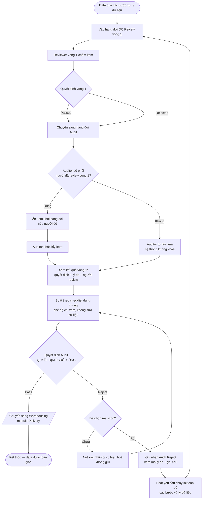
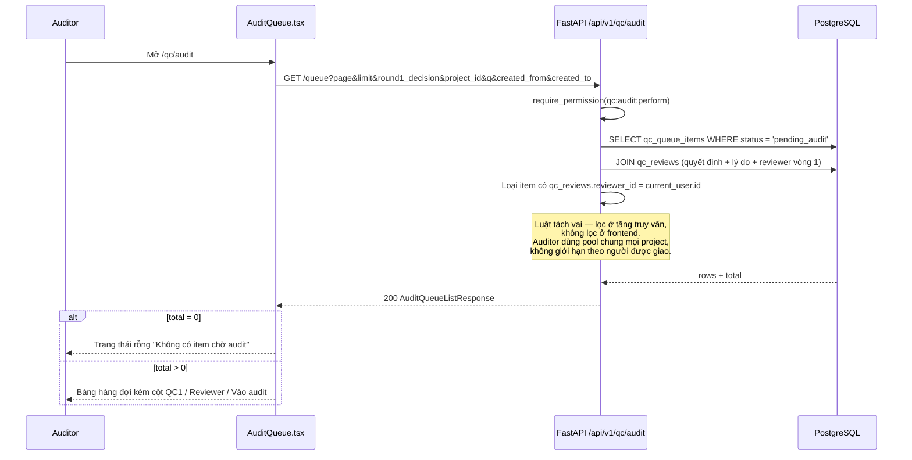
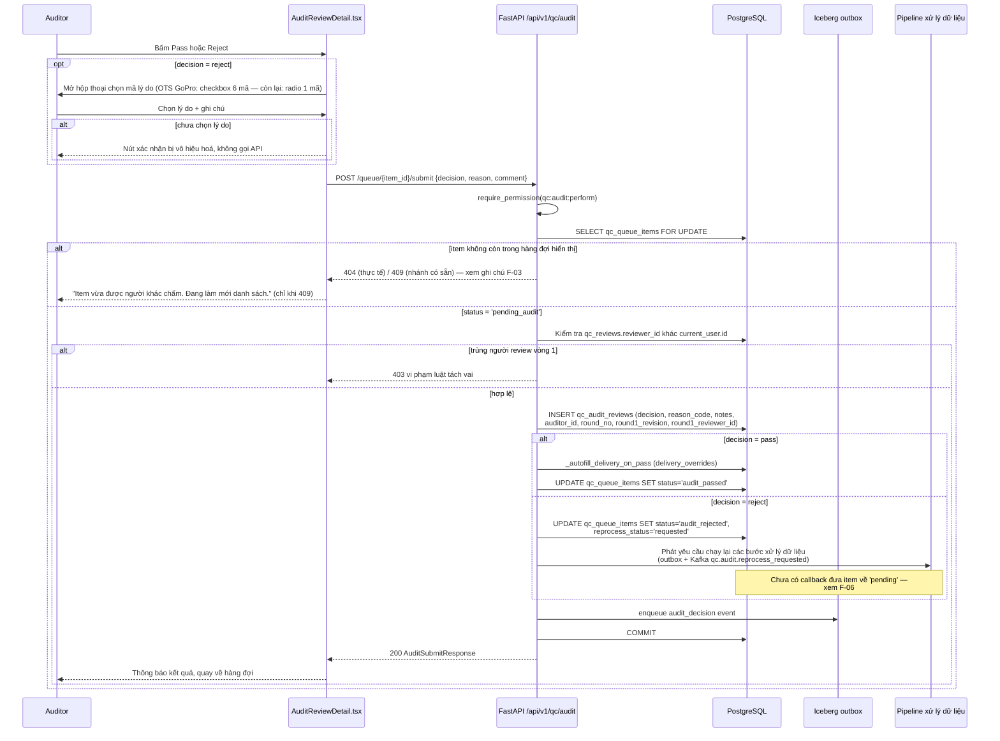

# QC Audit — Flows

## Flow: Audit vòng QC thứ 2 (Activity)

**Trigger:** Reviewer vòng 1 chấm xong một item (Pass hoặc Reject)

**Related US:** US-001, US-002, US-003, US-004

**Ghi chú nghiệp vụ:**

- Cả hai nhánh của vòng 1 (`Passed` và `Rejected`) đều vào hàng đợi Audit — 100% item, không nhánh nào được bỏ qua.
- Kết quả cuối chỉ phụ thuộc quyết định Audit. Vòng 1 `Rejected` + Audit `Pass` vẫn đi Warehousing — đây là đường cứu data bị loại oan.
- Vòng lặp `reprocess → queue1` không giới hạn số vòng ở phase này. Đây là quyết định có ý thức; điểm dừng để phase sau.
- **Vòng lặp đó hiện chưa khép kín trong code**: portal phát yêu cầu xử lý lại (`reprocess_status='requested'`, outbox + Kafka `qc.audit.reprocess_requested`) nhưng chưa có cơ chế nhận kết quả để `complete_audit_reprocess` đưa item về `pending`. Item đã bị reject hiện nằm ở `audit_rejected` cho tới khi có callback.
- **Tranh chấp hai auditor**: nhánh 409 có trong code nhưng khó chạy trên thực tế vì bước tra item đã lọc `status='pending_audit'` — item bị người khác chấm xong sẽ rơi vào 404. Xem ghi chú ở F-03 mục B của SRS.
- Màn chấm Audit hiện **chưa render checklist tiêu chí**; bộ tiêu chí vẫn nằm trong khối review vòng 1 mà API trả về (`review.criteria`).
- Warehousing là ranh giới ngoài phạm vi của sub-module Audit — phía Delivery nay có kho thật (`portal_warehouse_items`), màn `/warehousing` đọc `GET /api/v1/warehousing/items`; endpoint `GET /api/v1/delivery/warehousing/mock-items` cũ chỉ còn phục vụ bộ chọn item của đơn giao hàng.

## Flow: Load Audit Queue (Sequence)

**Trigger:** Auditor mở `/qc/audit`

**Related FR:** F-01

## Flow: Submit Audit Decision (Sequence)

**Trigger:** Auditor bấm Pass, hoặc bấm Reject và xác nhận trong hộp thoại

**Related FR:** F-03, F-05, F-06

