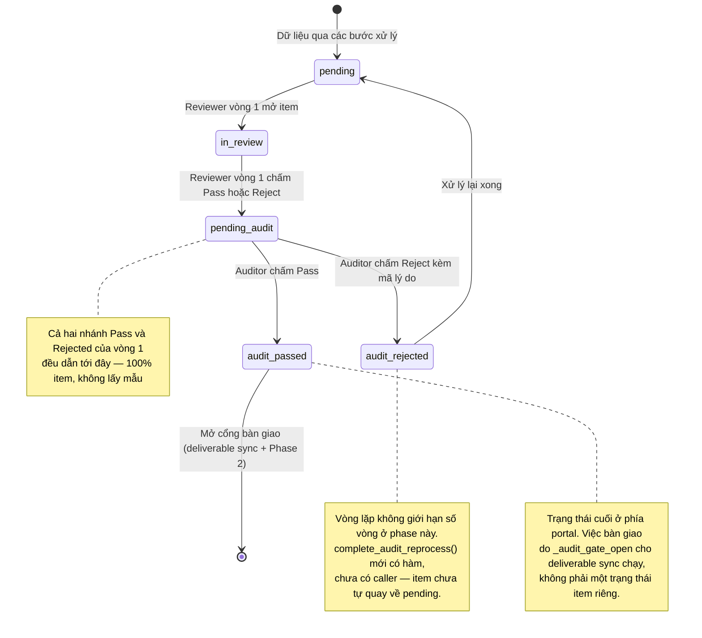

# QC Audit — States

## State: QcQueueItem (vòng đời qua hai vòng QC)

**Related FR:** F-04, F-05, F-06

**Trạng thái của `qc_queue_items` sau khi triển khai:**

| Trạng thái | Đã có? | Ghi chú |
| --- | --- | --- |
| `pending` | Có | Không đổi ngữ nghĩa; là đích quay về sau khi xử lý lại |
| `in_review` | Có | Không đổi ngữ nghĩa |
| `passed` | Có | **Không còn là trạng thái cuối của luồng mới** — vòng 1 Pass nay chuyển sang `pending_audit`. Chỉ còn trên dữ liệu cũ; `_audit_gate_open` vẫn cho các dòng `passed` legacy đi tiếp |
| `rejected` | Có | **Không còn là trạng thái cuối của luồng mới** — vòng 1 Reject nay cũng chuyển sang `pending_audit` |
| `needs_revision` | Có | **Có luồng sinh ra**: vòng 1 Reject đặt trạng thái này (`review_store.submit_review`); khi bật portal_flow, segment bị đẩy về bước `ANNOTATION`. Item không nằm trong hàng đợi Audit (hàng đợi chỉ lọc `status='pending_audit'`) |
| `pending_audit` | Có | Đã triển khai (`review_store.submit_review` đặt trạng thái này, kèm `audit_entered_at`) |
| `audit_passed` | Có | Đã triển khai (`audit_store.submit_audit_decision` nhánh pass). Trạng thái cuối phía portal |
| `audit_rejected` | Có | Đã triển khai (nhánh reject), kèm `reprocess_status='requested'`. Chưa có cơ chế đưa về `pending` |
| `delivered` | **Không** | Không tồn tại trong enum/portal status. Việc "trong kho" là nghiệp vụ phía Delivery, không phải trạng thái của `qc_queue_items` |

**Cột bổ sung trên `qc_queue_items`:** `audit_entered_at` (thời điểm vào hàng đợi Audit, hiển thị ở cột "Vào audit"), `reprocess_status` (`requested` khi vừa reject; `completed`/`failed` do `complete_audit_reprocess` đặt).
