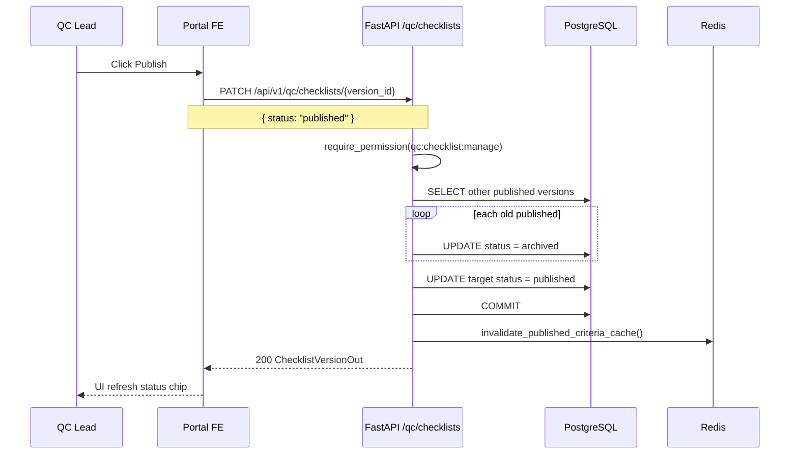
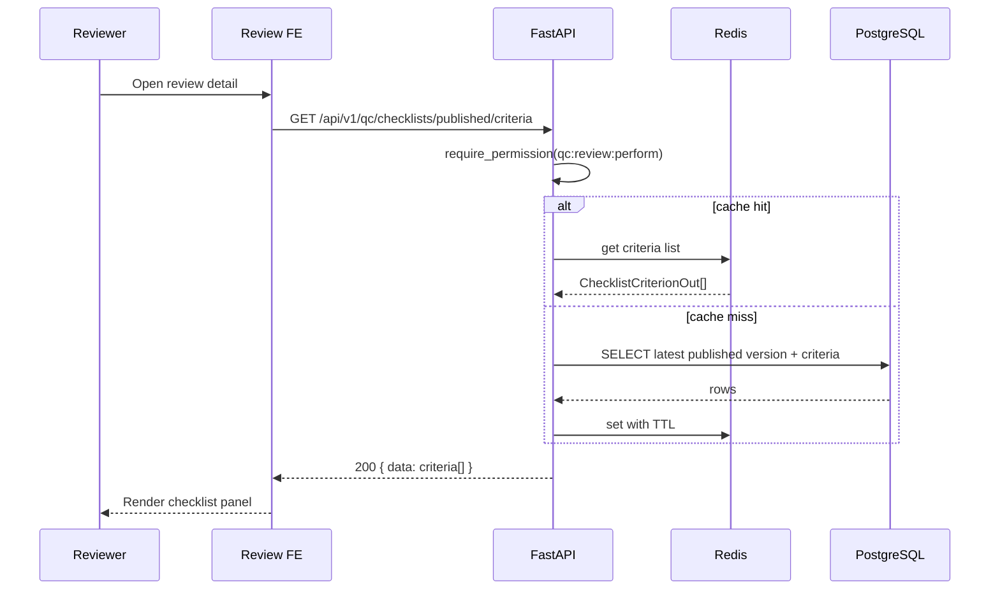

<!-- doc-meta: type=srs | feature=qc-checklists | status=draft | updated=2026-09-05 -->
# **SOFTWARE REQUIREMENTS SPECIFICATION**

Review Module — QC Checklists

Version 1.0 | 2026-09-05

## 1. INTRODUCTION

### 1.1. Purpose

Đặc tả kỹ thuật **QC Checklist versions** — CRUD version, criteria model, publish/archive, cache published criteria.

### 1.2. Scope

**IN SCOPE:** `backend/app/features/checklists/`, `frontend/src/features/checklists/QCChecklists.tsx`, API `/api/v1/qc/checklists/*`.

**OUT OF SCOPE:** Review detail render criteria; project checklist assignment UI.

**Integration:** PostgreSQL tables `checklist_versions`, `checklist_criteria`; Redis cache namespace `qc:checklist:published`.

### 1.3. Definitions

| Term | Definition |
| --- | --- |
| ChecklistVersion | `checklist_versions` row |
| ChecklistCriterion | `checklist_criteria` child rows |
| status | `draft` \| `published` \| `archived` |

## 2. SYSTEM OVERVIEW

### 2.1. Architecture

```
QCChecklists.tsx ──► GET/PATCH /qc/checklists ──► checklists/service.py ──► PostgreSQL
Review Detail    ──► GET /published/criteria ──► Redis cache (optional TTL)
```

**Wireframes:** `docs/review/qc-checklists/ascii-screen/`


### Sequence and Activity Diagrams

## Flow: Publish Checklist Version (Sequence)

**Trigger:** QC Lead bấm Publish

**Related FR:** F-04



## Flow: Load Published Criteria for Review (Sequence)

**Trigger:** Review detail mount

**Related FR:** F-06



## Flow: Create Version with Criteria (Activity)

**Trigger:** POST create (API ready; FE save button TBD)

**Related FR:** F-03

```mermaid

    Start((POST /checklists)) --> D1{status = published?}
    D1 -->|Yes| A1[Archive all published]
    D1 -->|No| A2[Skip archive]
    A1 --> A3[INSERT ChecklistVersion]
    A2 --> A3
    A3 --> A4[INSERT ChecklistCriterion rows]
    A4 --> D2{published?}
    D2 -->|Yes| A5[invalidate cache]
    D2 -->|No| End((201 DetailOut))
    A5 --> End
```

### 2.2. System User Profile

Copy URD §2.2.

## 3. FUNCTIONAL REQUIREMENTS

### 3.1 Function List

| ID | Function | Description | US |
| --- | --- | --- | --- |
| F-01 | List versions | GET all versions with criteria_count | US-001 |
| F-02 | Get version detail | GET version + criteria[] | US-001, US-002 |
| F-03 | Create version | POST version + criteria bulk insert | US-002 |
| F-04 | Patch version | PATCH version string / status publish | US-003 |
| F-05 | List options | GET published+draft for project picker | — |
| F-06 | Published criteria | GET active criteria for review | US-004 |

### 3.2 Function Detail

#### 3.2.1. F-01 List versions

**Endpoint:** `GET /api/v1/qc/checklists`  
**Auth:** `qc:checklist:manage`

**Response** (`200`, `ChecklistVersionListResponse`)

| No | Field | Type | Description |
| --- | --- | --- | --- |
| 1 | `data[]` | array | Version list. |
| 1.1 | `data[].id` | uuid | PK. |
| 1.2 | `data[].version` | string | Display version label. |
| 1.3 | `data[].status` | string | draft/published/archived. |
| 1.4 | `data[].created_by` | string | User display name. |
| 1.5 | `data[].criteria_count` | int | len(criteria). |
| 1.6 | `data[].created_at` | datetime | UTC. |
| 1.7 | `data[].updated_at` | datetime | UTC. |

---

#### 3.2.2. F-02 Get version detail

**Endpoint:** `GET /api/v1/qc/checklists/{version_id}`  
**Auth:** `qc:checklist:manage`

**Response** (`200`, `ChecklistVersionDetailOut`): F-01 fields + `criteria[]`

| No | Field | Type | Description |
| --- | --- | --- | --- |
| 1 | `criteria[].id` | uuid | Criterion PK. |
| 2 | `criteria[].name_en` | string | English label. |
| 3 | `criteria[].name_vi` | string | Vietnamese label. |
| 4 | `criteria[].section` | string | `auto` \| `manual`. |
| 5 | `criteria[].expected` | string | Expected value / rule text. |
| 6 | `criteria[].standard` | string | Standard reference. |
| 7 | `criteria[].sort_order` | int | Display order. |

**Errors:** 404 `Checklist version not found`.

---

#### 3.2.3. F-03 Create version

**Endpoint:** `POST /api/v1/qc/checklists`  
**Auth:** `qc:checklist:manage`  
**Status:** 201 Created

**Request Body** (`ChecklistVersionCreate`)

| No | Field | Type | Mandatory | Description |
| --- | --- | --- | --- | --- |
| 1 | `version` | string | Yes | Version label. |
| 2 | `status` | string | No | Default `draft`. |
| 3 | `criteria` | `ChecklistCriterionCreate[]` | No | Default `[]`. |
| 3.1 | `criteria[].name_en` | string | Yes | |
| 3.2 | `criteria[].name_vi` | string | Yes | |
| 3.3 | `criteria[].section` | string | No | Default `manual`. |
| 3.4 | `criteria[].expected` | string | No | |
| 3.5 | `criteria[].standard` | string | No | |
| 3.6 | `criteria[].sort_order` | int | No | Default index. |

**Response:** `ChecklistVersionDetailOut` (same as F-02).

**Business logic:** If `status=published` → archive existing published; invalidate cache.

---

#### 3.2.4. F-04 Patch version

**Endpoint:** `PATCH /api/v1/qc/checklists/{version_id}`  
**Auth:** `qc:checklist:manage`

**Request Body** (`ChecklistVersionPatch`)

| No | Field | Type | Description |
| --- | --- | --- | --- |
| 1 | `version` | string\|null | Rename version label. |
| 2 | `status` | string\|null | Publish → archive others. |

**Response:** `ChecklistVersionOut` (no embedded criteria).

**FE:** `QCChecklists.handlePublish()` → `{ status: "published" }`.

---

#### 3.2.5. F-05 List options

**Endpoint:** `GET /api/v1/qc/checklists/options`  
**Auth:** `project:view`

**Response** (`200`)

| No | Field | Type | Description |
| --- | --- | --- | --- |
| 1 | `data[].id` | uuid | |
| 2 | `data[].version` | string | |
| 3 | `data[].status` | string | published or draft only |
| 4 | `data[].criteria_count` | int | |

---

#### 3.2.6. F-06 Published criteria

**Endpoint:** `GET /api/v1/qc/checklists/published/criteria`  
**Auth:** `qc:review:perform`

**Response** (`200`)

| No | Field | Type | Description |
| --- | --- | --- | --- |
| 1 | `data` | `ChecklistCriterionOut[]` | Latest published version criteria; `[]` if none. |

**Cache:** `qc_checklist_cache_ttl_seconds` from settings; TTL ≤ 0 bypasses Redis.

---

#### 3.2.7. F-UI Criteria Builder

**Không có API** — `CriteriaBuilder` component:

- Local state `ChecklistCriterion[]` synced from `detail.criteria` on version change (`key={selectedId}`).
- `addCriterion()` → `newUuid()` client id.
- Operator `<select>` chưa bind state (gap — display only).
- **Publish** wired; **Save version** button not wired to POST F-03.

## 4. NON-FUNCTIONAL REQUIREMENTS

| ID | Requirement | Target | Priority |
| --- | --- | --- | --- |
| NFR-P-01 | List versions API | p95 < 500 ms | Medium |
| NFR-SEC-01 | Manage vs read split | manage / review permissions | High |
| NFR-M-01 | Cache invalidation | On every publish | High |
| NFR-U-01 | Bilingual criteria | name_en + name_vi required on create | Medium |

Không áp dụng: Compliance, horizontal scaling riêng.
