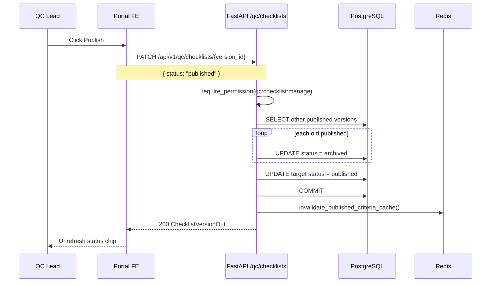
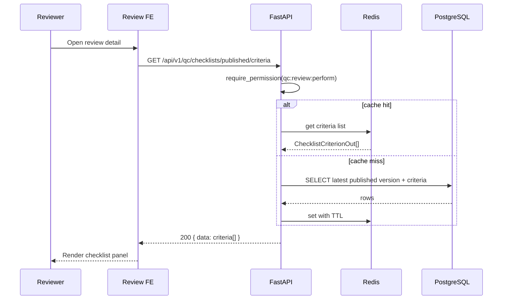
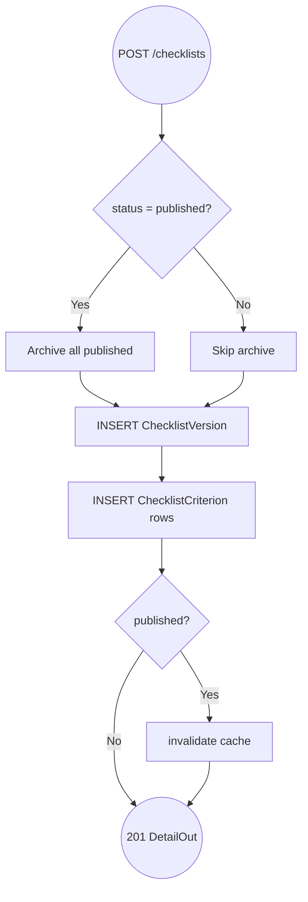

# QC Checklists — Flows

## Flow: Publish Checklist Version (Sequence)

**Trigger:** QC Lead bấm Publish

**Related FR:** F-04

## Flow: Load Published Criteria for Review (Sequence)

**Trigger:** Review detail mount

**Related FR:** F-06

## Flow: Create Version with Criteria (Activity)

**Trigger:** POST create (API ready; FE save button TBD)

**Related FR:** F-03

