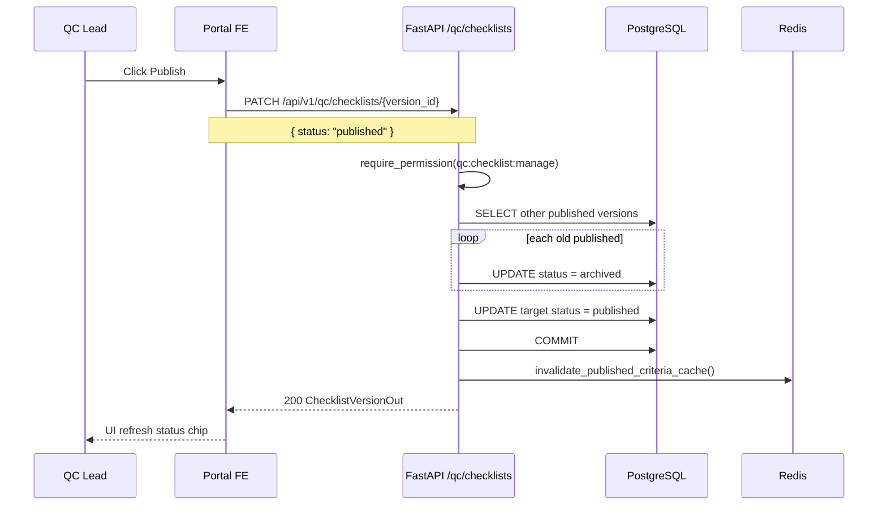
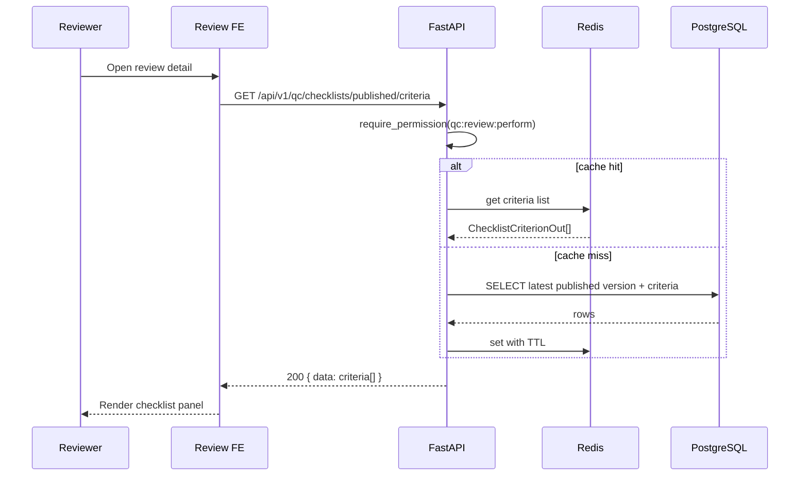
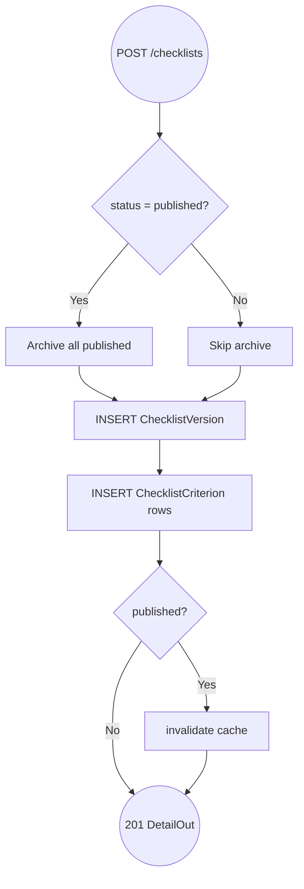

<!-- doc-meta: type=urd | feature=qc-checklists | status=draft | updated=2026-09-05 -->
# **User Requirement** Documentation

Review Module — QC Checklists

Version 1.0 | 2026-09-05

| **Version** | **Date** | **Author** | **Changes** |
| --- | --- | --- | --- |
| 1.0 | 2026-09-05 | @cursor-agent | Baseline từ checklists router + QCChecklists.tsx |

## 1. INTRODUCTION

### 1.1. Purpose

Baseline yêu cầu người dùng cho **QC Checklist Builder** — quản lý phiên bản tiêu chí QC dùng khi review video.

### 1.2. Scope

**IN SCOPE**

- Màn **Review → QC Checklists** (`/qc/checklists`).
- Sidebar danh sách version (draft / published / archived).
- Criteria builder: tên EN/VI, operator, expected, standard, section auto/manual.
- Publish version → trở thành checklist active cho review.
- API published criteria cho màn review.

**OUT OF SCOPE**

- Gắn checklist vào Project settings (chỉ `options` API).
- Review UI render criteria (module review detail).
- Import/export checklist Excel.
- Drag-drop reorder persist (UI có grip, chưa save order).

**Integration:** Review module đọc `GET /published/criteria`; Projects đọc `/options`.

### 1.3. Definitions

| Term | Definition |
| --- | --- |
| **Checklist version** | Bộ criteria có version string (vd `v2.1`) |
| **Criterion** | Một dòng tiêu chí trong checklist |
| **Published** | Version đang active cho review |
| **Section auto** | Tiêu chí tool tự động validate |
| **Section manual** | Reviewer nhập/đánh giá tay |

## 2. SYSTEM OVERVIEW

### 2.1. High-Level User Flow

1. QC Lead vào QC Checklists.
2. Chọn version ở sidebar → xem/sửa criteria trong builder.
3. Thêm/xóa criterion (local state).
4. Bấm **Publish** → version thành published; bản published cũ → archived.
5. Reviewer mở review → hệ thống load published criteria.

### Sequence and Activity Diagrams

## Flow: Publish Checklist Version (Sequence)

**Trigger:** QC Lead bấm Publish

**Related FR:** F-04

## Flow: Load Published Criteria for Review (Sequence)

**Trigger:** Review detail mount

**Related FR:** F-06

## Flow: Create Version with Criteria (Activity)

**Trigger:** POST create (API ready; FE save button TBD)

**Related FR:** F-03

### 2.2. System User Profile

| Role | Permission | Key Actions |
| --- | --- | --- |
| QC Lead | `qc:checklist:manage` | List, create, publish versions |
| QC Reviewer | `qc:review:perform` | Read published criteria only |
| PM | `project:view` | List checklist options |

## 3. USER STORIES

### 3.1. User Story List

| US Code | Title |
| --- | --- |
| US-001 | Xem danh sách version checklist |
| US-002 | Chỉnh sửa criteria trong version |
| US-003 | Publish version checklist |
| US-004 | Reviewer dùng checklist published |

### 3.2. User Story Detail

#### US-001 — Xem danh sách version checklist

**Story:** As a **QC Lead**, I want **xem các phiên bản checklist và trạng thái** so that **biết bản nào đang active**.

**Acceptance Criteria**

- **AC 1:** Given `qc:checklist:manage`, When mở `/qc/checklists`, Then sidebar hiển thị versions với version string, status chip, created_by, criteria_count.
- **AC 2:** Given versions load xong, When click một version, Then builder hiển thị criteria của version đó.
- **AC 3 (negative):** Given không có permission manage, When truy cập, Then auth guard chặn.

**Business Rules:** Sort `created_at DESC`; default chọn version đầu tiên.

**UI/UX:** 

---

#### US-002 — Chỉnh sửa criteria trong version

**Story:** As a **QC Lead**, I want **thêm/sửa/xóa tiêu chí** so that **checklist phản ánh quy trình QC mới**.

**Acceptance Criteria**

- **AC 1:** Given version đang chọn, When bấm "Thêm tiêu chí", Then thêm dòng trống với id mới (client UUID).
- **AC 2:** Given criterion row, When sửa nameEn/nameVi/expected/section, Then state cập nhật local.
- **AC 3:** Given bấm xóa, When confirm implicit, Then dòng biến mất khỏi builder.
- **AC 4 (gap):** When bấm Save version (dashed button), Then <!-- TBD: chưa wire POST create với criteria -->.

**Business Rules:** Operators: ≥, ≤, =, >, <, between, contains; section `auto`|`manual`.

**UI/UX:** 

---

#### US-003 — Publish version checklist

**Story:** As a **QC Lead**, I want **publish một version** so that **reviewer dùng checklist mới ngay**.

**Acceptance Criteria**

- **AC 1:** Given version draft, When bấm Publish, Then `PATCH` status=published thành công; chip hiển thị Published.
- **AC 2:** Given đã có version published khác, When publish version mới, Then version cũ chuyển archived (single active).
- **AC 3 (negative):** Given không có version selected, When bấm Publish, Then nút disabled.

**Business Rules:** Chỉ một published; invalidate cache `qc:checklist:published`.

**UI/UX:** 

---

#### US-004 — Reviewer dùng checklist published

**Story:** As a **QC Reviewer**, I want **thấy checklist published khi review** so that **đánh giá nhất quán theo tiêu chí công ty**.

**Acceptance Criteria**

- **AC 1:** Given có version published, When review detail load, Then `GET /published/criteria` trả danh sách criteria sorted.
- **AC 2:** Given không có published, When gọi API, Then `data: []`.
- **AC 3:** Given cache TTL > 0, When publish mới, Then cache invalidated — reviewer thấy criteria mới sau publish.

**Business Rules:** Permission `qc:review:perform`; read-only cho reviewer.

**UI/UX:** Ngoài scope màn checklists — review detail module.
