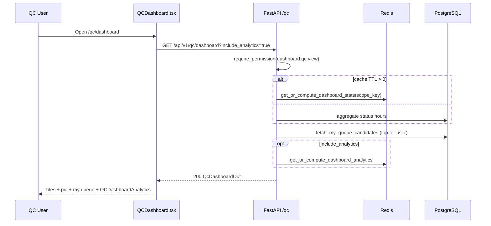
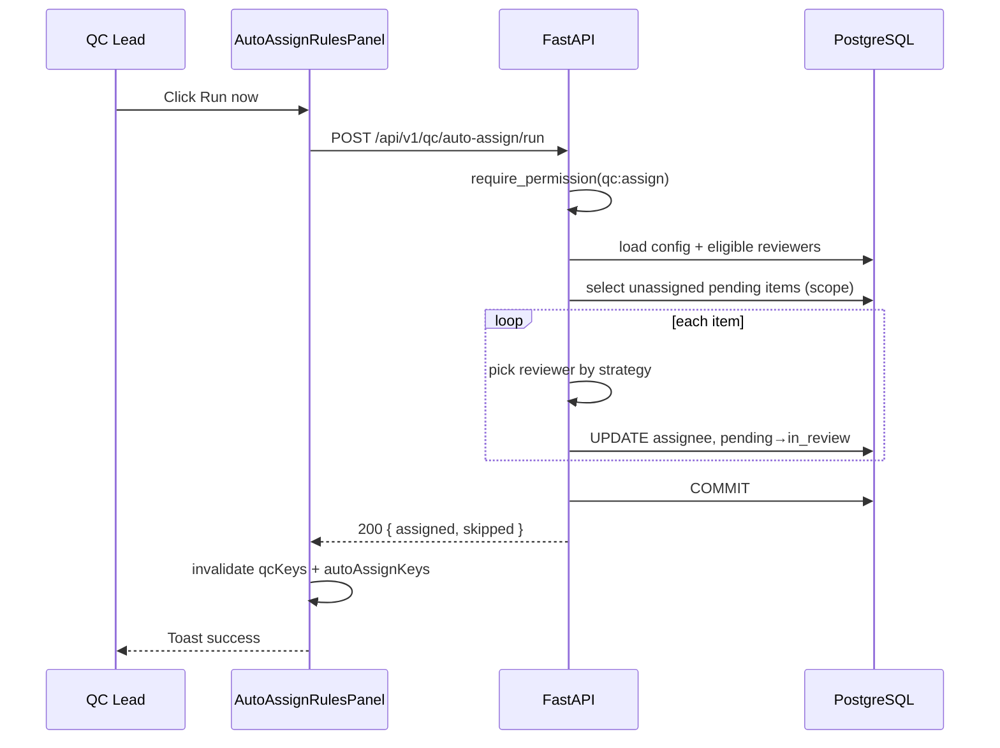
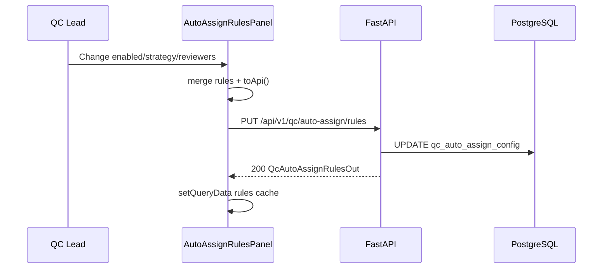

<!-- doc-meta: type=srs | feature=qc-dashboard | status=draft | updated=2026-09-05 -->
# **SOFTWARE REQUIREMENTS SPECIFICATION**

Review Module — QC Dashboard

Version 1.0 | 2026-09-05

## 1. INTRODUCTION

### 1.1. Purpose

Đặc tả kỹ thuật **QC Dashboard**, **Dashboard Analytics**, và **Auto-assign** APIs + FE components.

### 1.2. Scope

**IN SCOPE**

| Module | Path |
| --- | --- |
| Backend | `qc/router.py` dashboard + auto-assign endpoints; `service.dashboard`, `auto_assign.py` |
| Frontend | `QCDashboard.tsx`, `QCDashboardAnalytics.tsx`, `AutoAssignRulesPanel.tsx`, `useQcQueue` hooks |

**OUT OF SCOPE:** Queue list, review detail, checklist builder.

### 1.3. Definitions

| Term | Definition |
| --- | --- |
| QcDashboardOut | Aggregated counts + hours + my_queue + optional analytics |
| scope_key | Cache key from `visibility_scope_key(user, manual_annotation_only)` |
| AutoAssignStrategy | `round_robin` \| `least_loaded` \| `by_project` |

## 2. SYSTEM OVERVIEW

### 2.1. Architecture

```
QCDashboard.tsx ──GET /qc/dashboard──► service.dashboard() ──► PostgreSQL aggregates
                 ──GET analytics──────► dashboard_analytics / embedded
AutoAssignRulesPanel ──PUT/POST auto-assign──► auto_assign_service
```

**Wireframes:** `docs/review/qc-dashboard/ascii-screen/`


### Sequence and Activity Diagrams

## Flow: Load Dashboard (Sequence)

**Trigger:** Navigate `/qc/dashboard`

**Related FR:** F-01, F-02



## Flow: Auto-assign Run Now (Sequence)

**Trigger:** Lead clicks Run now

**Related FR:** F-06



## Flow: Save Auto-assign Rules (Sequence)

**Trigger:** Toggle/checkbox/select change

**Related FR:** F-04



## Flow: Dashboard vs Annotation Mode (Activity)

```mermaid

    Route["/qc/dashboard"] --> D1{mode}
    RouteA["/qc/annotation-dashboard"] --> Ann[manual_annotation_only=true]
    D1 --> QC[product_line default]
    QC --> Panel[AutoAssignRulesPanel visible if qc:assign]
    Ann --> Hide[Hide AutoAssign panel]
    Ann --> Link[CTA view_annotation_queue → /qc/annotation]
```

### 2.2. System User Profile

Copy URD §2.2.

## 3. FUNCTIONAL REQUIREMENTS

### 3.1 Function List

| ID | Function | Description | US |
| --- | --- | --- | --- |
| F-01 | Get dashboard | Stats hours + my_queue[:4] | US-001, US-002 |
| F-02 | Get dashboard analytics | Cohort analytics payload | US-003 |
| F-03 | Annotation dashboard | Same as F-01 with manual_annotation_only | US-001 |
| F-04 | Get/update auto-assign rules | GET/PUT config | US-004 |
| F-05 | List auto-assign reviewers | Eligible reviewers | US-004 |
| F-06 | Get auto-assign stats | unassigned, reassignable counts | US-005 |
| F-07 | Run auto-assign | Assign unassigned items | US-005 |
| F-08 | Run auto-reassign | Rebalance reassignable | US-005 |
| F-09 | Dashboard UI | Tiles, pie, my queue, analytics charts | US-001–003 |
| F-10 | Auto-assign panel UI | Rules form + actions | US-004, US-005 |

### 3.2 Function Detail

#### 3.2.1. F-01 Get dashboard

**Endpoint:** `GET /api/v1/qc/dashboard`  
**Auth:** `dashboard:qc:view`

**Query**

| Field | Type | Default | Description |
| --- | --- | --- | --- |
| `manual_annotation_only` | bool | false | Annotation mode |
| `include_analytics` | bool | false | Embed `analytics` object |

**Response** (`200`, `QcDashboardOut`)

| No | Field | Type | Description |
| --- | --- | --- | --- |
| 1 | `pending` | int | File count pending |
| 2 | `in_review` | int | Count in_review |
| 3 | `passed` | int | Count passed |
| 4 | `rejected` | int | Count rejected |
| 5 | `needs_revision` | int | Count needs_revision |
| 6 | `total_raw` | float | Total raw hours |
| 7 | `total_review` | float | Review pipeline hours |
| 8 | `total_pass` | float | Passed hours |
| 9 | `pending_hours` | float | Hours pending |
| 10 | `in_review_hours` | float | |
| 11 | `passed_hours` | float | |
| 12 | `rejected_hours` | float | |
| 13 | `needs_revision_hours` | float | |
| 14 | `total_hours` | float | Sum for pie |
| 15 | `my_queue[]` | QcQueueItemOut[] | Max 4 items for current user |
| 16 | `analytics` | QcDashboardAnalyticsOut\|null | If include_analytics |

**Cache:** `qc_dashboard_cache_ttl_seconds` per scope_key.

---

#### 3.2.2. F-02 Get dashboard analytics

**Endpoint:** `GET /api/v1/qc/dashboard/analytics`  
**Auth:** `dashboard:qc:view`

**Query:** `manual_annotation_only` (bool)

**Response** (`200`, `QcDashboardAnalyticsOut`)

| No | Field | Type | Description |
| --- | --- | --- | --- |
| 1 | `needs_review` | QcDashboardCohortOut | Cohort needing review |
| 2 | `passed` | QcDashboardCohortOut | Passed cohort |
| 3 | `assignee_pass_rates[]` | QcDashboardAssigneeRateOut | pass_rate per assignee |
| 4 | `ops` | QcDashboardOpsOut | unassigned, wip, metadata completeness |
| 5 | `pilot` | QcDashboardPilotOut\|null | target vs qa_passed_hours |
| 6 | `l1_caps[]` | QcDashboardCapOut | Environment L1 cap tracking |
| 7 | `difficulty_targets[]` | QcDashboardDifficultyTargetOut | |
| 8 | `skill_groups_covered` | int | |
| 9 | `skill_groups_target` | int | Default 18 |

**QcDashboardCohortOut fields:** `total_files`, `total_hours`, `by_assignee[]`, `by_status[]`, `by_project[]`, `by_environment_l1/l2/l3[]`, `by_task[]`, `by_skill_group[]`, `by_task_difficulty[]` — each bucket: `key`, `label`, `count`, `hours`.

---

#### 3.2.3. F-03 Annotation dashboard

**Endpoints:**

- `GET /api/v1/qc/annotation-dashboard` — `QcDashboardOut`, auth `qc:queue:view`, forces `manual_annotation_only=true`
- `GET /api/v1/qc/annotation-dashboard/analytics` — analytics only

---

#### 3.2.4. F-04 Auto-assign rules

**GET** `GET /api/v1/qc/auto-assign/rules`  
**PUT** `PUT /api/v1/qc/auto-assign/rules`  
**Auth:** `qc:assign`

**Response/Request** (`QcAutoAssignRulesOut` / `QcAutoAssignRulesUpdate`)

| Field | Type | Description |
| --- | --- | --- |
| `enabled` | bool | Master switch |
| `strategy` | string | round_robin \| least_loaded \| by_project |
| `max_queue_per_reviewer` | int | 1–50 |
| `auto_assign_high_priority` | bool | Prioritize critical/high |
| `reviewer_ids` | string[]\|null | null = all eligible |

**FE mapping:** `fromApi` / `toApi` in `AutoAssignRulesPanel.tsx`; defaults `DEFAULT_AUTO_ASSIGN_RULES`.

---

#### 3.2.5. F-05 List reviewers

**Endpoint:** `GET /api/v1/qc/auto-assign/reviewers`  
**Response:** `QcAutoAssignReviewerOut[]`

| Field | Type | Description |
| --- | --- | --- |
| `id` | string | User id |
| `username` | string | |
| `full_name` | string | |
| `groups` | string[] | Keycloak groups |

---

#### 3.2.6. F-06 Auto-assign stats

**Endpoint:** `GET /api/v1/qc/auto-assign/stats`

| Field | Type | Description |
| --- | --- | --- |
| `unassigned` | int | Pending without assignee |
| `reassignable` | int | Items eligible for rebalance |

---

#### 3.2.7. F-07 / F-08 Run assign & reassign

**POST** `/api/v1/qc/auto-assign/run`  
**POST** `/api/v1/qc/auto-assign/reassign`

**Response** (`QcAutoAssignRunResponse`)

| Field | Type | Description |
| --- | --- | --- |
| `assigned` | int | Items assigned/reassigned |
| `skipped` | int | Skipped (cap, no reviewer) |

---

#### 3.2.8. F-09 Dashboard UI

**Component:** `QCDashboard.tsx`

| Element | Data source | Behavior |
| --- | --- | --- |
| Stat tiles | `DASHBOARD_TILE_KEYS` × `tileValues` | Hours `.toFixed(1)` |
| Pie chart | `chartData` → `pieData` with i18n labels | Recharts; empty → `no_queue_data` |
| My queue | `my_queue` max 4 | ProjectLink, priority chip, review btn |
| Analytics | `QCDashboardAnalytics` | Separate loading `analyticsLoading` |
| Auto-assign panel | `canAssign && !isAnnotation` | Renders `AutoAssignRulesPanel` |

**Routes:** `/qc/dashboard` (mode final_qc), annotation variant via props.

---

#### 3.2.9. F-10 Auto-assign panel UI

**Component:** `AutoAssignRulesPanel.tsx`

| Control | API on change |
| --- | --- |
| Enabled checkbox | PUT rules |
| Strategy select | PUT rules |
| Reviewer multi-select | PUT `reviewer_ids` |
| Max queue number input | PUT `max_queue_per_reviewer` (min 1 max 50) |
| High priority checkbox | PUT rules |
| Run now | POST run |
| Reassign now | POST reassign |

**Disabled rules:** `!enabled`, `unassigned===0`, `reassignable===0`, `noReviewersSelected`, `busy`.

**On success:** invalidate `autoAssignKeys`, `qcKeys.dashboard`, `qcKeys.all`; `reload()` queue.

## 4. NON-FUNCTIONAL REQUIREMENTS

| ID | Requirement | Target | Priority |
| --- | --- | --- | --- |
| NFR-P-01 | Dashboard GET | p95 < 2500 ms with analytics | Medium |
| NFR-P-02 | Dashboard cache | Configurable TTL; scope-aware | Medium |
| NFR-SEC-01 | Permissions | dashboard:qc:view vs qc:assign split | High |
| NFR-A-01 | Auto-assign atomicity | DB commit per run; partial skip OK | Medium |
| NFR-U-01 | Responsive layout | tiles 1/2/5 cols sm/xl | Low |

Compliance / dedicated scalability: không áp dụng.
