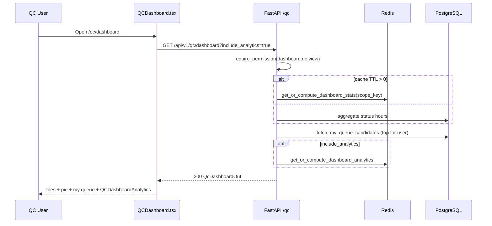
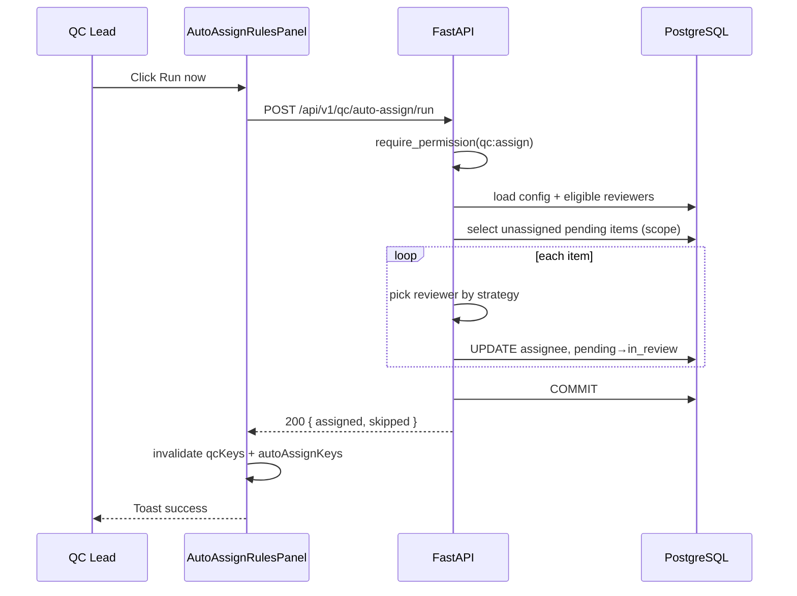
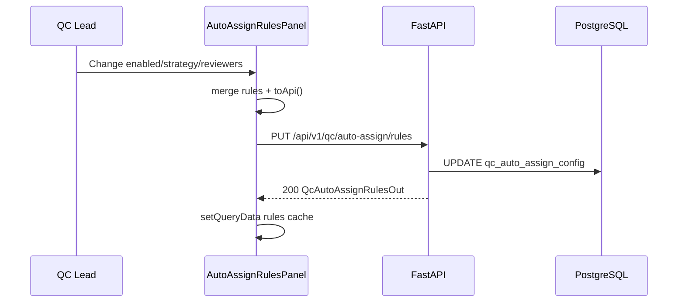
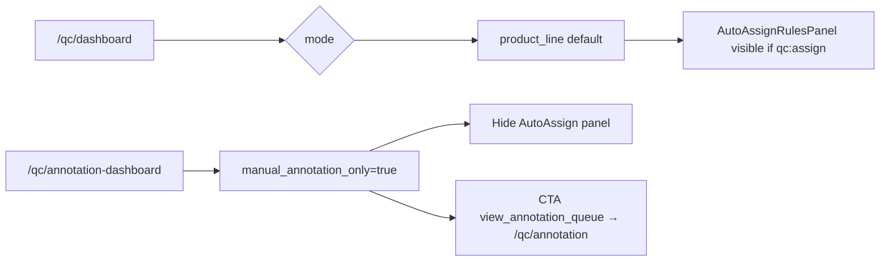

# QC Dashboard — Flows

## Flow: Load Dashboard (Sequence)

**Trigger:** Navigate `/qc/dashboard`

**Related FR:** F-01, F-02

## Flow: Auto-assign Run Now (Sequence)

**Trigger:** Lead clicks Run now

**Related FR:** F-06

## Flow: Save Auto-assign Rules (Sequence)

**Trigger:** Toggle/checkbox/select change

**Related FR:** F-04

## Flow: Dashboard vs Annotation Mode (Activity)

