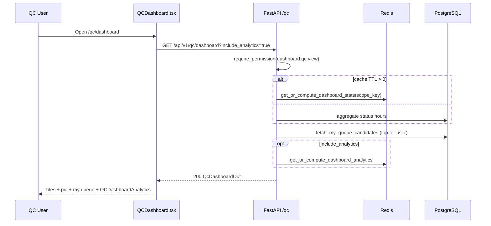
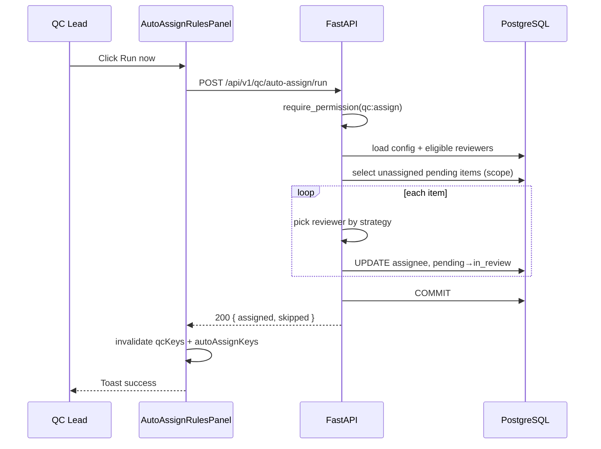
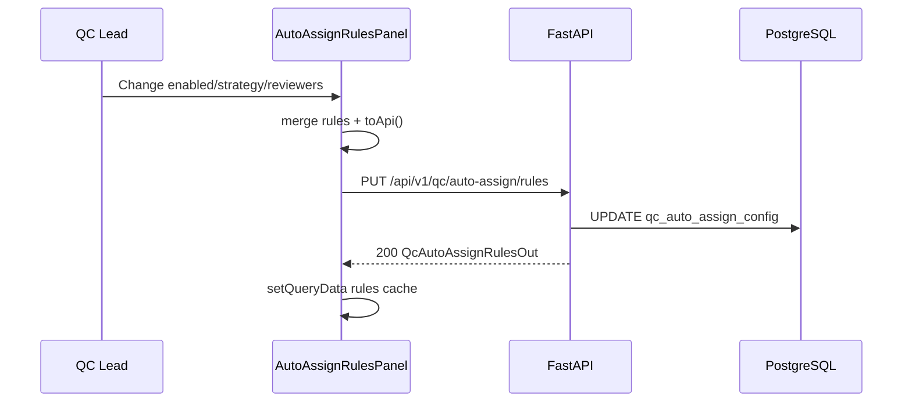
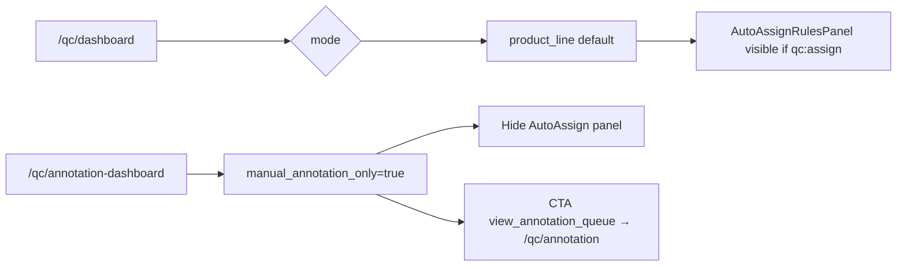

<!-- doc-meta: type=urd | feature=qc-dashboard | status=draft | updated=2026-09-05 -->
# **User Requirement** Documentation

Review Module — QC Dashboard

Version 1.0 | 2026-09-05

## 1. INTRODUCTION

### 1.1. Purpose

Baseline yêu cầu **QC Dashboard** và **Auto-assign** — tổng quan workload QC, my queue, analytics, phân công tự động.

### 1.2. Scope

**IN SCOPE**

- `/qc/dashboard` — stat tiles (hours), pie chart, my queue (4 items), analytics section.
- `/qc/annotation-dashboard` — cùng layout, `manual_annotation_only`.
- Auto-assign panel: rules, reviewers picker, run/reassign.
- Link "Xem tất cả" → QC Queue; "Mở review" per item.

**OUT OF SCOPE**

- QC Queue list/export (doc `qc-queue`).
- Review detail.
- Email digest / scheduled auto-assign cron (background có `run_auto_assign_background` — ops).

### 1.3. Definitions

| Term | Definition |
| --- | --- |
| **Hours metric** | Tổng duration video trong cohort, đơn vị giờ |
| **My Queue** | Items assigned current user, ưu tiên mở review |
| **Auto-assign** | Thuật toán gán pending items cho reviewers |
| **Reassignable** | Items có thể rebalance (stats API) |

## 2. SYSTEM OVERVIEW

### 2.1. High-Level User Flow

1. User mở QC Dashboard.
2. Xem tiles + pie + my queue.
3. Scroll analytics (cohort charts, pilot, caps) nếu enabled.
4. (Lead) Cấu hình auto-assign → Run now / Reassign now.
5. Click item → review detail; "Xem tất cả" → queue list.

### Sequence and Activity Diagrams

## Flow: Load Dashboard (Sequence)

**Trigger:** Navigate `/qc/dashboard`

**Related FR:** F-01, F-02

## Flow: Auto-assign Run Now (Sequence)

**Trigger:** Lead clicks Run now

**Related FR:** F-06

## Flow: Save Auto-assign Rules (Sequence)

**Trigger:** Toggle/checkbox/select change

**Related FR:** F-04

## Flow: Dashboard vs Annotation Mode (Activity)

### 2.2. System User Profile

| Role | Permission | Actions |
| --- | --- | --- |
| QC Reviewer | `dashboard:qc:view` | View dashboard, my queue |
| QC Lead | + `qc:assign` | Auto-assign panel |
| Annotation user | `qc:queue:view` | Annotation dashboard variant |

## 3. USER STORIES

### 3.1. User Story List

| US Code | Title |
| --- | --- |
| US-001 | Xem tổng quan workload QC |
| US-002 | Xem và mở My Queue |
| US-003 | Xem analytics nâng cao |
| US-004 | Cấu hình auto-assign rules |
| US-005 | Chạy auto-assign / reassign |

### 3.2. User Story Detail

#### US-001 — Xem tổng quan workload QC

**Story:** As a **QC Lead**, I want **xem tổng giờ video theo trạng thái** so that **nắm tiến độ team**.

**Acceptance Criteria**

- **AC 1:** Given `dashboard:qc:view`, When mở dashboard, Then 5 tiles hiển thị totalRaw, pending, in_review, passed, rejected (đơn vị giờ, 1 chữ thập phân).
- **AC 2:** Given có data, When render pie, Then legend theo `qcStatusLabel` và tooltip giờ.
- **AC 3:** Given loading, When fetch chưa xong, Then tiles hiển thị "—".

**UI/UX:** 

---

#### US-002 — Xem và mở My Queue

**Story:** As a **QC Reviewer**, I want **thấy video được gán cho tôi** so that **bắt đầu review nhanh**.

**Acceptance Criteria**

- **AC 1:** Given user có assigned items, When load dashboard, Then my queue hiển thị tối đa 4 dòng: filename, project, duration, priority, age.
- **AC 2:** When click "Mở review", Then navigate `qcReviewPath(mode, id)`.
- **AC 3:** Given không có assignment, Then message `no_items_assigned`.

---

#### US-003 — Xem analytics nâng cao

**Story:** As a **QC Lead**, I want **analytics cohort (needs_review vs passed)** so that **phân tích theo assignee/project/environment**.

**Acceptance Criteria**

- **AC 1:** Given `include_analytics=true`, When data loaded, Then `QCDashboardAnalytics` render charts (assignee bars, cohort pies, pilot progress, L1 caps).
- **AC 2:** Given analytics loading, Then skeleton/loading state không crash layout.

**UI/UX:** Embedded trong overview wireframe — analytics section below fold.

---

#### US-004 — Cấu hình auto-assign rules

**Story:** As a **QC Lead**, I want **bật/tắt và cấu hình auto-assign** so that **phân công tự động theo policy**.

**Acceptance Criteria**

- **AC 1:** Given `qc:assign`, When toggle Enabled, Then `PUT /auto-assign/rules` persist ngay.
- **AC 2:** When đổi strategy / max queue / reviewers / high-priority, Then save qua PUT.
- **AC 3:** Given `enabled=false`, When UI, Then form disabled (opacity 50%).
- **AC 4 (negative):** Given reviewerIds=[] explicit, When Run, Then buttons disabled.

**UI/UX:** 

---

#### US-005 — Chạy auto-assign / reassign

**Story:** As a **QC Lead**, I want **chạy assign hoặc reassign ngay** so that **giảm backlog unassigned**.

**Acceptance Criteria**

- **AC 1:** Given enabled + unassigned>0 + reviewers selected, When Run now, Then POST run → toast với số `assigned`.
- **AC 2:** Given reassignable>0, When Reassign now, Then POST reassign → toast reassigned count.
- **AC 3 (negative):** Given API fail, Then toast `auto_assign_run_failed`.

**Business Rules:** Invalidate dashboard + queue queries sau success.
