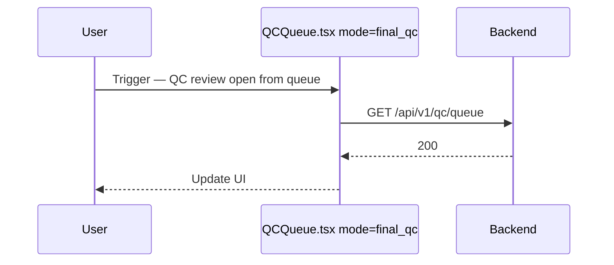

<!-- doc-meta: type=srs | feature=qc-queue | status=draft | updated=2026-09-25 -->
# **SOFTWARE REQUIREMENTS SPECIFICATION**

Review Module — QC Queue

Version 1.4 | 2026-09-25

| **Version** | **Date** | **Author** | **Changes** |
| --- | --- | --- | --- |
| 1.4 | 2026-09-25 | @kimi-code | Giữ lựa chọn khi đổi trang; bulk assign chia theo tổng thời lượng |
| 1.3 | 2026-09-22 | @binhhm | Gộp thanh chọn vào `QCQueueSelectionBar`; selection reset theo filter/trang; QC reviewer là thành viên project (Members tab) thấy được queue của project |
| 1.2 | 2026-09-11 | @binhhm | Đối chiếu code: route `/qc/review` (`/qc/queue` redirect), `qc:review:perform` cho chi tiết item, modal Gán có chọn nhanh theo nhóm người dùng (`user:manage` được tạo nhóm nhanh) + lỗi 422 khi trộn 2 mode assign, siết mô tả gate export |
| 1.1 | 2026-09-10 | @binhhm | Redesign F-05 Bulk assign: multi-reviewer round-robin + cross-page/filter selection persistence (US-006); tách Export thành nút cố định + chế độ chọn riêng, độc lập khỏi Assign |
| 1.0 | 2026-09-05 | @cursor-agent | SRS đầy đủ — kế thừa urd.md, brainstorm, ascii-screen |

**Table of Contents**

1. **INTRODUCTION**
2. **SYSTEM OVERVIEW**
3. **FUNCTIONAL REQUIREMENTS**
4. **NON-FUNCTIONAL REQUIREMENTS**

## 1. INTRODUCTION

### 1.1. Purpose

- Đặc tả kỹ thuật **QC Review Queue** — API list/filter/assign/export, FE `QCQueue.tsx`, visibility scope.
- Đối tượng: backend/frontend dev, QA, architect.
- Kế thừa `docs/review/qc-queue/urd.md` v2.4; traceability `US-xxx` → `F-xx`.

### 1.2. Scope

**IN SCOPE (technical)**

| Module | Build |
| --- | --- |
| Backend | `backend/app/features/qc/router.py` — queue list, assign, export, sync; `service.list_queue`, `bulk_assign`, `queue_export` |
| Frontend | `frontend/src/features/qc/QCQueue.tsx`, `QCQueueTable.tsx`, `QCQueueSelectionBar.tsx`, `QCQueueBulkAssignDialog.tsx`, `QCQueueExportDialog.tsx`, `qc-queue-filters.ts`, `qc-queue-selection.ts` |
| API prefix | `/api/v1/qc/queue/*`, `/api/v1/qc/sync`; modal Gán đọc nhóm reviewer qua `/api/v1/admin/users/groups*` |
| Routes | `/qc/review` (queue, mode `final_qc`) và `/qc/review/:id` (chi tiết); URL cũ `/qc/queue` redirect → `/qc/review`; annotation `/qc/annotation` |
| Auth | Keycloak + `qc:queue:view` (queue), `qc:review:perform` (chi tiết), `qc:assign`, `qc:result:export` |

**OUT OF SCOPE (technical)**

- Review detail APIs (`/qc/queue/{id}/review`, playback, submit) — module review detail.
- Dashboard (`/qc/dashboard`) — doc `qc-dashboard`.
- Auto-assign rules (`/qc/auto-assign/*`) — doc `qc-dashboard` (queue chỉ consume reviewers list).
- Checklist APIs — doc `qc-checklists`.

**Integration boundary**

| System | Protocol | Direction | Behavior |
| --- | --- | --- | --- |
| Keycloak | OIDC | Portal ↔ IdP | SSO; JWT → permissions |
| Admin user groups | Internal REST | FE → Backend | Chọn nhanh reviewer theo nhóm trong modal Gán: `GET /api/v1/admin/users/groups` + `GET /api/v1/admin/users/groups/{name}/members` (đọc mirror Postgres); tạo nhóm nhanh `POST /api/v1/admin/users/groups` + `PUT …/members` khi user có `user:manage` |
| PostgreSQL | SQLAlchemy | Backend ↔ DB | `qc_queue_items`, `qc_reviews`, `projects`, `qc_export_jobs` |
| Lakehouse sync | Internal | Read/write queue | `sync_from_ingestion` |
| Redis (optional) | Cache | Read | Queue total cache 30s; dashboard TTL riêng |

### 1.3. Definitions and Acronyms

| **Term** | **Definition** |
| --- | --- |
| **SRS / FR** | Function `F-{NN}` |
| **NFR** | `NFR-{CAT}-{NN}` |
| **QcQueueItem** | ORM `qc_queue_items` |
| **Visibility scope** | SQL filter theo user role + project assignment. Reviewer **không** có `qc:assign` chỉ thấy item được gán cho mình — **trừ** khi là thành viên project ở Members tab với role `qc_reviewer`, khi đó thấy cả queue của project (nhánh `lakehouse_mode="review"`; `review_queue_assignee_only` quyết định cache key). Platform admin và người có `qc:assign` không bị lọc theo assignee |
| **product_line** | Query: `all` (final QC), `tapdata` (TapData queue) |
| **manual_annotation_only** | Query bool — annotation queue mode |
| **REVIEWABLE** | FE set: `pending`, `in_review`, `needs_revision` |
| **DEFAULT_PRIORITY** | `medium` (`priority.py`) — writer lakehouse dùng hằng này; giá trị cũ `normal` đã backfill về `medium` (DP-380) |
| **LARGE_EXPORT_WARNING_THRESHOLD** | 10_000 rows (`queue_export.py`) |

## 2. SYSTEM OVERVIEW

### 2.1. High-Level Architecture

```
┌──────────────────┐   HTTPS JSON    ┌─────────────────────────────┐
│ React FE         │ ───────────────►│ FastAPI features/qc/        │
│ /qc/review       │                 │ router + service + export   │
│ QCQueue.tsx      │ ◄───────────────│                             │
└──────────────────┘                 └──────────┬──────────────────┘
                                                │
                         ┌──────────────────────┼──────────────────────┐
                         ▼                      ▼                      ▼
                   PostgreSQL              Redis cache            Ingestion/Lakehouse
                 qc_queue_items           (total 30s)            (sync source)
```

**Tech stack:** React 18, Vite, TanStack Query, React Router 7, FastAPI, SQLAlchemy 2, Pydantic v2.

**Wireframes:** `docs/review/qc-queue/ascii-screen/`


### Sequence and Activity Diagrams

## Flow: QC review open from queue (Sequence)



### 2.2. System User Profile

| **User Role** | **Description** | **Permission Level** | **Key Actions** |
| --- | --- | --- | --- |
| QC Reviewer | Review assigned videos; thành viên project (Members tab) thấy cả queue của project | `qc:queue:view`, `qc:review:perform` | List (scoped), open review |
| QC Lead | Assign + export | + `qc:assign`, `qc:result:export` | Bulk assign, export |
| Admin / `vd_qc_leads` | Cross-project | + `dashboard:admin` or role | `canFilterAllProjects` |
| Admin (`user:manage`) | Tạo nhóm nhanh trong modal Gán | + `user:manage` | Tạo nhóm người dùng + thêm reviewer đang chọn vào nhóm |
| System | Sync job | `qc:queue:view` | `POST /qc/sync` |

## 3. FUNCTIONAL REQUIREMENTS

### 3.1 Function List

| **ID** | **Function Name** | **Description (technical)** | **Traceability** |
| --- | --- | --- | --- |
| F-01 | List queue | Paginated list + filters; visibility scope; product_line / manual_annotation_only. | US-001 |
| F-02 | Get queue item | Single item detail by id or external_id. | US-001 |
| F-03 | List batch filters | Distinct batch tags for filter dropdown (API ready). | US-001 |
| F-04 | List assignee filters | Distinct assignees + eligible reviewers. | US-001 |
| F-05 | Bulk assign (đơn/nhóm) | POST assign — hỗ trợ gán 1 hoặc nhiều reviewer (FE chia cân bằng theo tổng thời lượng, cho sửa tay trước khi gửi); pending→in_review; project access; bỏ qua item đã có người gán; 422 nếu gửi đồng thời cả 2 mode hoặc không gửi mode nào. | US-006 |
| F-06 | Export preview | Count + scope + large warning. | US-003 |
| F-07 | Export download | Scope `selected`: xlsx/csv binary đồng bộ; scope `filtered`: tạo job nền, poll, rồi tải file. | US-003 |
| F-08 | Sync queue | Pull from ingestion/lakehouse. | — (ops) |
| F-09 | Queue page UI | URL-sync filters, saved views, pagination 20. | US-001, US-005 |
| F-10 | Navigate to review | FE routing + nextIds state. | US-004 |
| F-11 | Reviewer group quick select (FE) | Modal Gán gọi API nhóm người dùng để tick nhanh reviewer theo nhóm; user có `user:manage` tạo nhóm nhanh từ trong modal. | US-006 |

### 3.2 Function Detail

#### 3.2.1. F-01 List queue

##### A. Flow

**Description**

| **Step** | **Actor** | **Description** |
| --- | --- | --- |
| 1 | User | Mở `/qc/review` (URL cũ `/qc/queue` redirect sang đây); FE `readQcQueueFilters(searchParams)`. |
| 2 | FE | Resolve `project_id` (UUID hoặc `resolveProjectFilterId`). |
| 3 | FE | `GET /api/v1/qc/queue` với `limit=20`, filters, `product_line` hoặc `manual_annotation_only`. |
| 4 | Backend | `visible_queue_list_stmt` + filter clauses; sort `created_at DESC`. |
| 5 | Backend | Count total (cache 30s nếu page=1 và không filter). |
| 6 | FE | Map → `QCQueueTable`; subtitle total từ `pagination.total`. |

##### B. API Specification

**Endpoint:** `GET /api/v1/qc/queue`  
**Method:** GET  
**Auth:** `qc:queue:view`

**Request**

| **No** | **Field** | **Data type** | **Default** | **Mandatory** | **Description** |
| --- | --- | --- | --- | --- | --- |
| **Header** | | | | | |
| 1 | `Authorization` | string | — | Yes | Bearer Keycloak. |
| **Query** | | | | | |
| 2 | `page` | integer | 1 | No | ≥ 1. |
| 3 | `limit` | integer | 50 | No | 1–500; FE dùng 20. |
| 4 | `project_id` | uuid | — | No | Filter project. |
| 5 | `status` | string | — | No | `pending\|in_review\|passed\|rejected\|needs_revision`; omit/`all` = no filter. |
| 6 | `priority` | string | — | No | `critical\|high\|medium\|low`. |
| 7 | `assignee_id` | string | — | No | User id hoặc `__unassigned__`. |
| 8 | `q` | string | — | No | ILIKE filename, external_id, assignee, id, ingest_job_id, project name. |
| 9 | `created_from` | date string | — | No | GMT+7 day start → UTC. |
| 10 | `created_to` | date string | — | No | GMT+7 day end inclusive. |
| 11 | `batch_id` | string | — | No | Filter tag batch (API; FE TBD). |
| 12 | `manual_annotation_only` | boolean | false | No | Annotation queue. |
| 13 | `product_line` | string | — | No | `tapdata` hoặc `all` (final QC). |

**Response** (`200`, `QcQueueListResponse`)

| **No** | **Field** | **Data type** | **Description** |
| --- | --- | --- | --- |
| 1 | `data[]` | `QcQueueItemOut[]` | Queue rows. |
| 1.1 | `data[].id` | string (uuid) | PK. |
| 1.2 | `data[].external_id` | string | Upload / external ref. |
| 1.3 | `data[].upload_id` | string\|null | |
| 1.4 | `data[].project_id` | string (uuid) | |
| 1.5 | `data[].project_name` | string | Join projects. |
| 1.6 | `data[].filename` | string | Display name. |
| 1.7 | `data[].duration` | string | Humanized duration. |
| 1.8 | `data[].status` | string | Queue status enum. |
| 1.9 | `data[].priority` | string | Priority enum. |
| 1.10 | `data[].assignee_id` | string\|null | |
| 1.11 | `data[].assignee_name` | string | "Unassigned" default. |
| 1.12 | `data[].assignee_initials` | string | Avatar initials. |
| 1.13 | `data[].age` | string | Relative age label. |
| 1.14 | `data[].thumbnail_color` | string | Hex color. |
| 1.15 | `data[].created_at` | datetime (UTC) | ISO 8601. |
| 1.16 | `data[].updated_at` | datetime (UTC) | |
| 1.17 | `data[].stereo_review` | boolean | Stereo flag. |
| 1.18 | `data[].reject_reason_code` | string\|null | If rejected. |
| 1.19 | `data[].reject_comment` | string\|null | |
| 1.20 | `data[].tags` | string[] | Includes batch tags. |
| 1.21 | `data[].batch_id` | string\|null | Derived batch. |
| 2 | `pagination.page` | integer | Echo. |
| 3 | `pagination.limit` | integer | Echo. |
| 4 | `pagination.total` | integer | Matching count. |
| 5 | `error.detail` | string | 401/403. |

---

#### 3.2.2. F-02 Get queue item

##### A. Flow

| **Step** | **Actor** | **Description** |
| --- | --- | --- |
| 1 | Client | `GET /api/v1/qc/queue/{item_id}`. |
| 2 | Backend | Resolve by `id` or `external_id`; visibility check. |
| 3 | Backend | Enrich project name, review, duration mirror. |
| 4 | System | 404 `QC queue item not found` nếu ngoài scope. |

##### B. API Specification

**Endpoint:** `GET /api/v1/qc/queue/{item_id}`  
**Auth:** `qc:queue:view`

**Request**

| **No** | **Field** | **Data type** | **Mandatory** | **Description** |
| --- | --- | --- | --- | --- |
| 1 | `Authorization` | string | Yes | Bearer. |
| 2 | `item_id` | string | Yes | UUID hoặc external_id. |

**Response** (`200`): `QcQueueItemOut` — cùng schema F-01 `data[]` item.

---

#### 3.2.3. F-05 Bulk assign (đơn/nhóm)

##### A. Flow

**Description**

| **Step** | **Actor** | **Description** |
| --- | --- | --- |
| 1 | Lead | Tick các item cần gán trên trang hiện tại — selection là state FE (`assignSelected`), không postback tới lúc gán; đổi trang giữ nguyên lựa chọn, chỉ đổi filter mới reset (xem F-09) nên muốn gán cả tập khớp lọc thì dùng "Chọn hết" ở banner. |
| 2 | Lead | Bấm **Phân công** trên thanh chọn để mở modal Gán; chọn 1 hoặc nhiều reviewer trong picker (search theo tên/username/nhãn nhóm + tick). Danh sách reviewer lấy từ `GET /api/v1/qc/auto-assign/reviewers`. |
| 2b | Lead | (tuỳ chọn) "Chọn nhanh theo nhóm": FE gọi `GET /api/v1/admin/users/groups` để đổ danh sách nhóm; chọn nhóm → `GET /api/v1/admin/users/groups/{name}/members` → tick các thành viên khớp reviewer. |
| 2c | Lead | (chỉ khi có `user:manage`) Bấm "Tạo nhóm" để tạo nhóm mới rồi thêm các reviewer đang tick vào nhóm: `POST /api/v1/admin/users/groups` + `PUT /api/v1/admin/users/groups/{name}/members`. |
| 3 | FE | Nếu ≥2 reviewer được chọn: client-side chia cân bằng theo tổng thời lượng (`buildBalancedAssignMap`) — item dài nhất trước, gán cho reviewer đang ít thời lượng nhất; hiện bảng preview cho Lead sửa tay từng dòng. |
| 4 | FE | Nếu batch > 200 item: hiện checkbox xác nhận phụ; nút "Xác nhận gán" bị vô hiệu cho tới khi Lead tick. |
| 5 | Lead | Bấm Xác nhận. FE gọi `POST /qc/queue/assign` — 1 người: body single-assignee mode (`item_ids` + `assignee_*`, không đổi so với trước); ≥2 người: body multi-assignee mode (`assignments[]`, mỗi phần tử đã map sẵn item→reviewer). |
| 6 | Backend | Với mỗi (item, assignee): resolve trong scope + `ensure_assignee_project_access`; kiểm tra item còn hợp lệ (chưa bị người khác gán). |
| 7 | Backend | Hợp lệ → set assignee fields, `pending` → `in_review`; không hợp lệ → bỏ qua, đếm vào `skipped`. |
| 8 | Backend | Commit; trả `updated`, `skipped`, và `assignee_breakdown` (multi-assignee mode) để FE dựng toast "cho {K} người". |
| 9 | System | 404 nếu `updated=0` (không có item nào hợp lệ trong toàn bộ request). |

**Chọn "tất cả N mục khớp bộ lọc"** (FE): không có endpoint mới — FE gọi `GET /qc/queue` (limit=500, cùng bộ filter) nhiều lần tuần tự cho tới khi gom đủ N `item_ids`, rồi gộp vào 1 lần gọi `POST /qc/queue/assign` duy nhất. `item_ids`/`assignments` trên endpoint assign không có cap.

##### B. API Specification

**Endpoint:** `POST /api/v1/qc/queue/assign`  
**Auth:** `qc:assign`

**Request Body** (`QcAssignRequest` — mở rộng, backward-compatible với single-assignee mode hiện có)

| **No** | **Field** | **Data type** | **Mandatory** | **Description** |
| --- | --- | --- | --- | --- |
| 1 | `item_ids` | string[] | Có nếu dùng single-assignee mode | Giữ nguyên hành vi hiện tại; min_length=1. |
| 2 | `assignee_name` | string | Có nếu dùng single-assignee mode | Giữ nguyên. |
| 3 | `assignee_initials` | string | No | Giữ nguyên, default `"—"`. |
| 4 | `assignee_id` | string\|null | No | Giữ nguyên; portal user id, preferred. |
| 5 | `assignments` | `{item_id, assignee_id, assignee_name, assignee_initials}[]` | Có nếu dùng multi-assignee mode (≥2 reviewer) | **Mới** — mapping item→reviewer đã tính sẵn ở FE (chia cân bằng theo tổng thời lượng + sửa tay). Mutually exclusive với `item_ids`/`assignee_*`; request chỉ dùng ĐÚNG 1 trong 2 mode. |

**Response** (`200`, `QcAssignResponse` — mở rộng)

| **No** | **Field** | **Data type** | **Description** |
| --- | --- | --- | --- |
| 1 | `updated` | integer | Tổng số item gán thành công (cả 2 mode). |
| 2 | `assignee_name` | string\|null | Echo — chỉ có ở single-assignee mode; `null` ở multi-assignee mode. |
| 3 | `skipped` | integer | **Mới** — số item bị bỏ qua (không còn hợp lệ tại thời điểm gán). |
| 4 | `assignee_breakdown` | `{assignee_name, count}[]` | **Mới** — chỉ có ở multi-assignee mode; FE dùng để dựng toast "cho {K} người". |
| 5 | `error.detail` | string | 403 insufficient; 404 no matching items; 422 khi gửi đồng thời `item_ids` và `assignments`, khi không gửi mode nào, hoặc single-assignee mode thiếu `assignee_name`. |

---

#### 3.2.4. F-06 Export preview

##### B. API Specification

**Endpoint:** `POST /api/v1/qc/queue/export/preview`  
**Auth:** `qc:result:export` (via `require_qc_queue_export`)

**Request Body** (`QcQueueExportPreviewRequest`)

| **No** | **Field** | **Data type** | **Default** | **Description** |
| --- | --- | --- | --- | --- |
| 1 | `item_ids` | string[] | `[]` | Non-empty → scope `selected`. |
| 2–10 | Filter fields | — | — | Same as F-01 query: `project_id`, `status`, `priority`, `assignee_id`, `q`, `created_from`, `created_to`, `manual_annotation_only`, `product_line`. |

**Response** (`200`, `QcQueueExportPreviewOut`)

| **No** | **Field** | **Data type** | **Description** |
| --- | --- | --- | --- |
| 1 | `count` | integer | Rows to export. |
| 2 | `scope` | string | `selected` \| `filtered`. |
| 3 | `large_export_warning` | boolean | `true` if count > 10000. |

---

#### 3.2.5. F-07 Export download

**Endpoint:** `POST /api/v1/qc/queue/export` (scope `selected`)  
**Auth:** `qc:result:export`

**Request Body** (`QcQueueExportRequest`): preview fields + `format` (`xlsx`|`csv`, default `xlsx`).

**Response** (`200`): raw bytes; headers `Content-Disposition: attachment; filename="..."`, `media_type` application/vnd.openxmlformats-officedocument.spreadsheetml.sheet hoặc text/csv UTF-8 BOM.

**Scope `filtered` chạy nền (DP-382):** "Xuất tất cả" không build file trong request nữa — FE gọi `POST /api/v1/qc/queue/export/jobs` (trả ngay `{id, status, ready}`), poll `GET /api/v1/qc/queue/export/jobs/{job_id}`, rồi `GET /api/v1/qc/queue/export/jobs/{job_id}/download` (409 khi job chưa xong hoặc đã `failed`). Job nằm trong Postgres (`qc_export_jobs`) nên poll rơi vào worker nào cũng đọc được; job thuộc riêng người tạo (`requested_by`), người khác poll/download nhận 404. Chi tiết xem `docs/review/qc-review-export-list/srs.md`.

---

#### 3.2.6. F-08 Sync queue

**Endpoint:** `POST /api/v1/qc/sync?project_id={optional}`  
**Auth:** `qc:queue:view`

**Response** (`200`, `QcSyncResponse`)

| **Field** | **Type** | **Description** |
| --- | --- | --- |
| `fetched` | int | Rows read from source. |
| `upserted` | int | Insert/update count. |
| `skipped` | int | Skipped. |
| `pruned` | int | Removed stale (default 0). |

---

#### 3.2.7. F-09 Queue page UI

**Không có API riêng** — xử lý FE:

| Concern | Implementation |
| --- | --- |
| Route | `/qc/review` (mode `final_qc`; annotation ở `/qc/annotation`); URL cũ `/qc/queue` redirect → `/qc/review` |
| URL params | `readQcQueueFilters` / `writeQcQueueFilters` |
| Page size | `QC_QUEUE_PAGE_SIZE = 20` |
| Saved views | `ListFiltersBar` + `qcFiltersToSavedParams` |
| Project scope | `canFilterAllProjects` = `DASHBOARD_ADMIN` \|\| `vd_qc_leads` |
| Reset selection theo filter (bỏ qua `page`) | `selectionResetKey = JSON.stringify({ filters: selectionScope, projectId: resolvedProjectId })` với `selectionScope = filters` đã bỏ `page` → `useEffect` gọi `clearSelection()`: `assignSelected` về rỗng, `assignSelectedMeta` về rỗng, `assignOpen=false`, `dismissSelectAllBanner=false`. **Đổi filter mới reset; đổi trang giữ nguyên lựa chọn** (DP-394); effect cũng chạy một lần lúc mount (xoá tập rỗng ban đầu, no-op) |
| Một tập chọn duy nhất | Chỉ còn `assignSelected` (+ `assignSelectedMeta` giữ id → row để tên file sống sót khi item rời trang). Biến chế độ chọn và tập chọn riêng cho Export đã bỏ — checkbox cột luôn tác động lên `assignSelected` |
| Select-all-by-filter | Khi tick hết trang hiện tại, hiện banner gợi ý mở rộng chọn toàn bộ N item khớp filter — gate `canAssign && allPageSelected && !dismissSelectAllBanner && pagination.total > pageIds.length`; FE gom đủ ID qua nhiều lần gọi `GET /qc/queue` (limit=500/lần), không cần API mới |
| Thanh chọn hợp nhất | `QCQueueSelectionBar` — render **chỉ khi** `assignSelected.size > 0`, theo thứ tự: badge `bulk_assign_selected` ("Đã chọn {count} mục") → nút **Phân công** (gate `qc:assign`) → **Xuất theo lựa chọn** (`qc_export_selected_action`, gate `qc:result:export`, disabled khi preview đang load hoặc `selectedCount === 0`) → **Xuất tất cả {count} mục khớp lọc** (`qc_export_filtered_action`, gate `qc:result:export`, `{count}` = `pagination.total`, disabled khi preview đang load hoặc `filteredTotal === 0`) → link **Hủy** (`cancel`) gọi `clearSelection()`. Nút Export ở header đã bỏ (PageShell không còn dùng prop `actions`) |
| Snapshot cho modal Gán | `QCQueueBulkAssignDialog` nhận `selectedItems` là snapshot từ `assignSelected`/`assignSelectedMeta` (id + filename + duration); dialog tự quản state reviewer, map chia cân bằng theo thời lượng (`buildBalancedAssignMap`) và bảng preview, gọi `onConfirm(payload)` rồi cha mới gọi API |
| Export "tất cả" chạy nền | Scope `filtered` bất đồng bộ (3 endpoint job, xem F-07); scope `selected` vẫn đồng bộ. Chi tiết hành vi Export xem `docs/review/qc-review-export-list/srs.md` (feature riêng, cùng `QCQueue.tsx`) |

---

#### 3.2.8. F-10 Navigate to review

**Không có API** — FE `openReview()`:

- Path: `qcReviewPath(mode, item.id)` → `/qc/review/{id}` (mode `final_qc`) hoặc `/qc/annotation/{id}` (mode `annotation`).
- `nextIds` = các item REVIEWABLE còn lại trên trang hiện tại; kèm `returnSearch` = query string của màn queue để nút quay lại giữ nguyên bộ lọc.
- Route chi tiết yêu cầu quyền `qc:review:perform` (`RequirePermission` trong `App.tsx`), không chỉ `qc:queue:view`.

## 4. NON-FUNCTIONAL REQUIREMENTS

### 4.1 Performance

| ID | Requirement | Metric/Target | Priority |
| --- | --- | --- | --- |
| NFR-P-01 | List API latency | p95 < 2000 ms @ limit=20, 1 filter | High |
| NFR-P-02 | Export preview | p95 < 3000 ms @ count < 1000 | Medium |
| NFR-P-03 | Queue total cache | TTL 30s when page=1 no filters | Low |
| NFR-P-04 | Bulk assign (multi-reviewer) | p95 < 5000 ms cho batch 50–200 item | Medium |
| NFR-P-05 | Export "tất cả" không chặn request | Trả job < 2000 ms; file build bởi worker nền, FE poll 2 s/lần, timeout 10 phút | Medium |

### 4.2 Availability

| ID | Requirement | Metric/Target | Priority |
| --- | --- | --- | --- |
| NFR-A-01 | Portal uptime | 99.5% monthly (shared portal SLA) | Medium |

### 4.3 Security

| ID | Requirement | Metric/Target | Priority |
| --- | --- | --- | --- |
| NFR-SEC-01 | RBAC | Mọi endpoint `require_permission` | High |
| NFR-SEC-02 | Row-level scope | Items ngoài `visible_queue_*` → 404/not listed | High |
| NFR-SEC-03 | Export permission | `qc:result:export` **và** user thuộc một nhóm SSO trong `QC_QUEUE_EXPORT_GROUPS` (`vd-admins`, `vd-platform-engineers`, `vd-qc-leads`, `vd-project-managers`) — `require_qc_queue_export` | High |
| NFR-SEC-04 | Export job ownership | Job lọc theo `requested_by`; người khác poll/download → 404 | High |

### 4.4 Scalability

Không áp dụng riêng — dùng shared PostgreSQL + pagination.

### 4.5 Maintainability

| ID | Requirement | Metric/Target | Priority |
| --- | --- | --- | --- |
| NFR-M-01 | API tests | `backend/tests/features/qc/test_queue_export.py` cover export; `test_export_jobs.py` + `test_export_job_routes.py` cover job nền | Medium |

### 4.6 Usability

| ID | Requirement | Metric/Target | Priority |
| --- | --- | --- | --- |
| NFR-U-01 | Filter persistence | URL shareable; saved views | Medium |
| NFR-U-01 | i18n | VI/EN via `createTranslator` | Medium |

### 4.7 Compliance

Không áp dụng cho feature nội bộ queue list.

### NFR Summary Table

| **ID** | **Requirement** | **Metric/Target** | **Priority** |
| --- | --- | --- | --- |
| NFR-P-01 | List latency | p95 < 2s | High |
| NFR-SEC-01 | RBAC | Keycloak permissions enforced | High |
| NFR-SEC-02 | Visibility scope | No cross-project leak | High |
| NFR-U-01 | URL-sync filters | 100% filter keys in URL | Medium |
