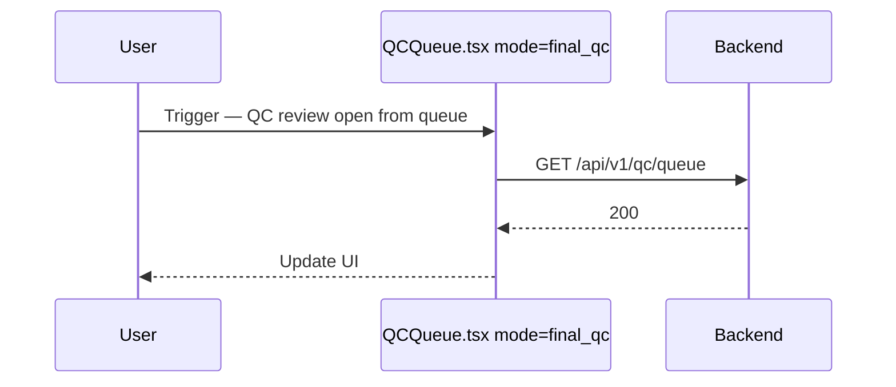
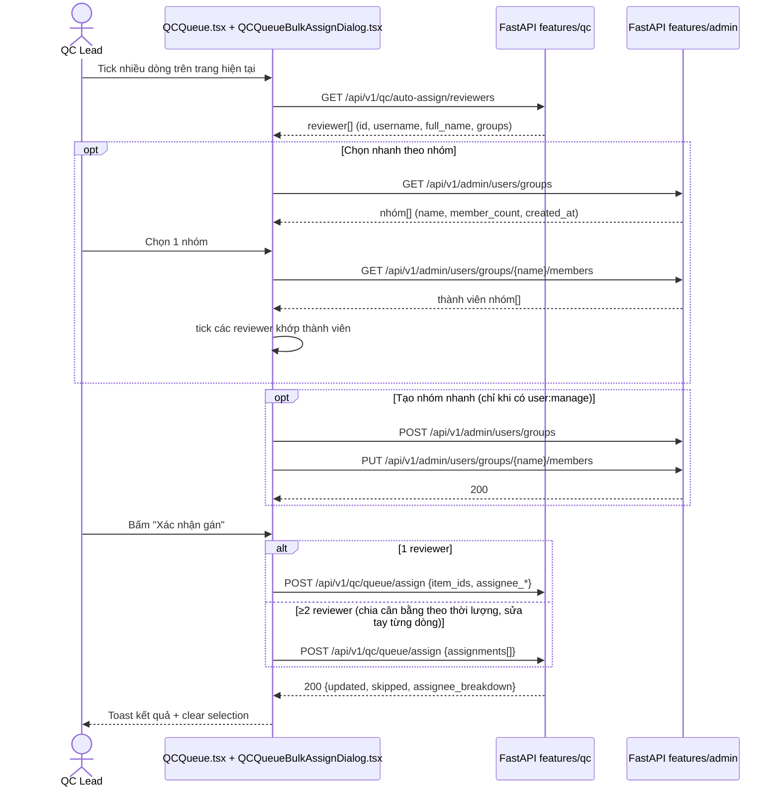
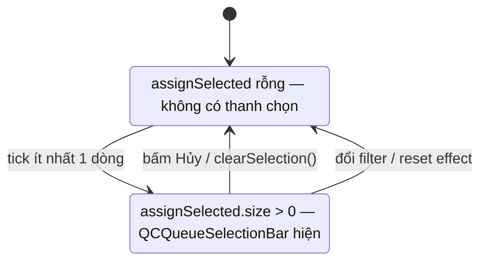

# QC Review Queue — Flows

## Flow: QC review open from queue (Sequence)

## Flow: Gán hàng loạt (multi-reviewer + chọn nhanh theo nhóm)

## Flow: Chọn và xuất trên màn Queue (một thanh chọn hợp nhất)

Không còn chế độ chọn để xuất: `assignSelected` là tập chọn duy nhất, checkbox cột luôn tác động lên nó. `QCQueueSelectionBar` chỉ render khi `assignSelected.size > 0` và mang cả 2 nhóm hành động (Gán / Xuất) — nên "bật chế độ xuất" không còn tồn tại như một trạng thái.

- Ở `ChuaChon`: không tick dòng nào → `QCQueueSelectionBar` không render, và banner "chọn hết" cũng không hiện.
- Ở `DaChon`: thanh chọn hiện badge "Đã chọn {N} mục" + **Phân công** (gate `qc:assign`) + **Xuất theo lựa chọn** / **Xuất tất cả {M} mục khớp lọc** (gate `qc:result:export`) + **Hủy**; tick hết trang thì banner chọn-theo-lọc hiện thêm.
- Reset khi đổi filter là **một chiều** (đổi trang thì lựa chọn được giữ nguyên) — sau reset phải tick lại từ đầu; effect `selectionResetKey` cũng xoá `assignOpen` và `dismissSelectAllBanner`.

