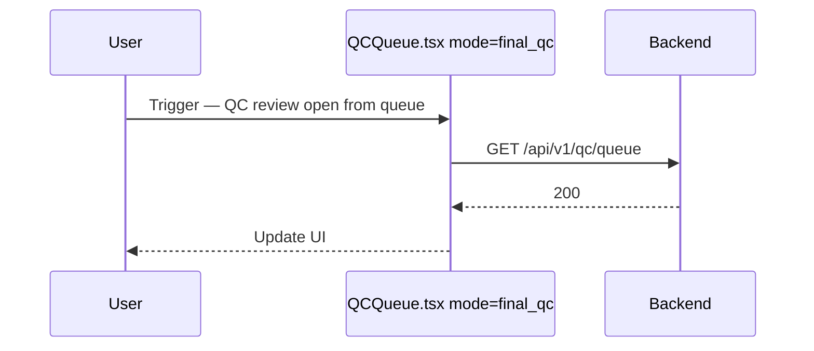

<!-- doc-meta: type=urd | feature=docs/review/qc-queue | updated=2026-09-25 -->
# **User Requirement** Documentation

QC Review Queue

Version 2.4 | 2026-09-25

| **Version** | **Date** | **Author** | **Changes** |
| --- | --- | --- | --- |
| 2.4 | 2026-09-25 | @kimi-code | Giữ lựa chọn khi đổi trang; bulk assign chia theo tổng thời lượng |
| 2.3 | 2026-09-22 | @binhhm | Đảo Business Rule US-006: lựa chọn video nay reset khi đổi filter/trang |
| 2.2 | 2026-09-11 | @binhhm | Đối chiếu code đã ship: route thật `/qc/review` (`/qc/queue` redirect), wording toast Bulk assign theo i18n, batch lớn cần tick xác nhận, chọn nhanh theo nhóm có trong modal |

## 1. INTRODUCTION

**1.1. Purpose** — Baseline nghiệp vụ `QC Review Queue` cho PM/dev/QA.

**1.2. Scope** — IN: - product_line=all
- shared filters/export/assign
- detail /qc/review/:id — OUT: - Annotation queue
- QC detail sub-features

## 2. System Overview

**2.1. Flow:** Login → `/qc/review` (màn hàng đợi, mode `final_qc`) → thao tác chính; URL cũ `/qc/queue` tự chuyển hướng sang `/qc/review`, màn annotation ở `/qc/annotation`.

**2.2. Roles:** Màn hàng đợi cần `qc:queue:view`; mở chi tiết `/qc/review/:id` cần `qc:review:perform`; gán hàng loạt cần `qc:assign`.

### Sequence and Activity Diagrams

## Flow: QC review open from queue (Sequence)

## 3. User Stories

| US | Name | Description |
| --- | --- | --- |
| US-001 | Xem hàng đợi QC | Reviewer mở item final QC |
| US-002 | Export kết quả QC | Lead export CSV/JSON |
| US-006 | Gán hàng loạt cho nhiều reviewer | Lead chọn nhiều video (chọn cả tập khớp bộ lọc nếu cần), gán cho 1 hoặc nhiều reviewer (tự chia cân bằng theo tổng thời lượng, sửa tay trước khi xác nhận) |

<!-- US-003..US-005 đã được srs.md tham chiếu (Export/Navigate/Saved views) nhưng chưa có story detail tương ứng ở đây — gap có sẵn, ngoài phạm vi thay đổi này. US-006 dùng để tránh trùng số khi bổ sung sau. -->

#### 3.2.1 US-001 Xem hàng đợi QC

**As a** user **I want** reviewer mở item final qc **So that** I complete work on QC Review Queue.

**AC 1:** Given permission `qc:queue:view`, When open route, Then data loads.
**AC 2:** Given no permission, When access, Then forbidden or hidden nav.

**UI:** `docs/review/qc-queue/ascii-screen/`

#### 3.2.2 US-002 Export kết quả QC

**As a** user **I want** lead export csv/json **So that** I complete work on QC Review Queue.

**AC 1:** Given permission `qc:queue:view`, When open route, Then data loads.
**AC 2:** Given no permission, When access, Then forbidden or hidden nav.

**UI:** `docs/review/qc-queue/ascii-screen/`

#### 3.2.3 US-006 Gán hàng loạt cho nhiều reviewer

**As a** QC Lead **I want** chọn nhiều video (có thể là cả tập khớp bộ lọc hiện tại) và gán cho 1 hoặc nhiều reviewer cùng lúc **So that** tôi phân chia công việc nhanh cho cả nhóm mà không phải lặp lại thao tác từng người.

**AC 1:** Given đã chọn N video và chọn đúng 1 reviewer, When bấm Xác nhận gán, Then toàn bộ N video hợp lệ được gán cho reviewer đó, hệ thống báo "Đã phân công {N} mục cho {tên}".
**AC 2:** Given đã chọn N video và chọn ≥2 reviewer, When xác nhận, Then hệ thống tự động chia video cân bằng theo tổng thời lượng của từng reviewer, hiển thị bảng xem trước cho sửa tay từng dòng, và sau khi xác nhận báo "Đã gán {N} mục cho {K} người".
**AC 3 (negative):** Given batch có video đã bị người khác gán trong lúc Lead đang thao tác, When xác nhận gán, Then hệ thống bỏ qua các video đó và báo rõ "Đã gán {X}/{Y} mục — {Z} mục không gán được".
**AC 4 (negative):** Given chưa chọn reviewer nào trong modal, When cố xác nhận, Then nút "Xác nhận gán" bị vô hiệu và modal hiện lỗi "Chọn ít nhất 1 người để gán".
**AC 5:** Given Lead dùng ô "Chọn nhanh theo nhóm" và chọn 1 nhóm, When nhóm có thành viên nằm trong danh sách reviewer QC, Then hệ thống tick các reviewer đó và báo "Đã thêm {X} reviewer QC hợp lệ từ nhóm"; nếu không có ai hợp lệ thì báo "Không có reviewer QC hợp lệ trong nhóm này".

**Business Rules:**
- Lựa chọn video **giữ nguyên khi đổi trang** và chỉ **reset khi đổi bộ lọc** (DP-394) — muốn gán cho cả tập khớp bộ lọc hiện tại thì tick hết trang rồi bấm "Chọn hết" trên banner gợi ý, hoặc bấm "Bỏ chọn" để tự xoá.
- Batch > 200 video → modal hiện checkbox xác nhận phụ; nút "Xác nhận gán" bị vô hiệu cho tới khi Lead tick checkbox đó.
- Chia cân bằng theo **tổng thời lượng**: video dài nhất xét trước, gán cho reviewer đang có tổng thời lượng ít nhất (hoà thì ưu tiên người ít video hơn); không tính tải hiện tại của reviewer (V1) — Lead có thể sửa tay từng dòng trước khi xác nhận.
- Danh sách nhóm trong modal lấy từ API nhóm người dùng (đọc mirror Postgres, đồng bộ Keycloak nền mỗi 300s) — xem `docs/authorization/users-admin/`. Người có `user:manage` thấy thêm nút "Tạo nhóm" để tạo nhóm nhanh rồi thêm luôn các reviewer đang tick vào nhóm đó.

**UI:** [[docs/review/qc-queue/ascii-screen/qc-queue-list.md|Thanh chọn cập nhật]], [[docs/review/qc-queue/ascii-screen/qc-queue-bulk-assign.md|Modal Gán hàng loạt]]

